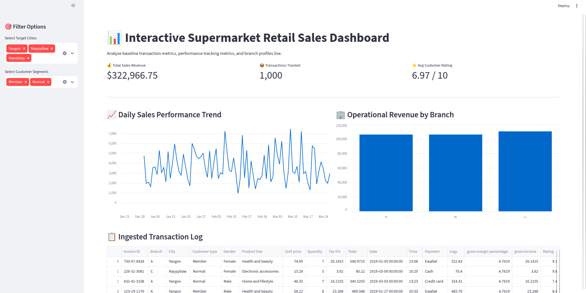
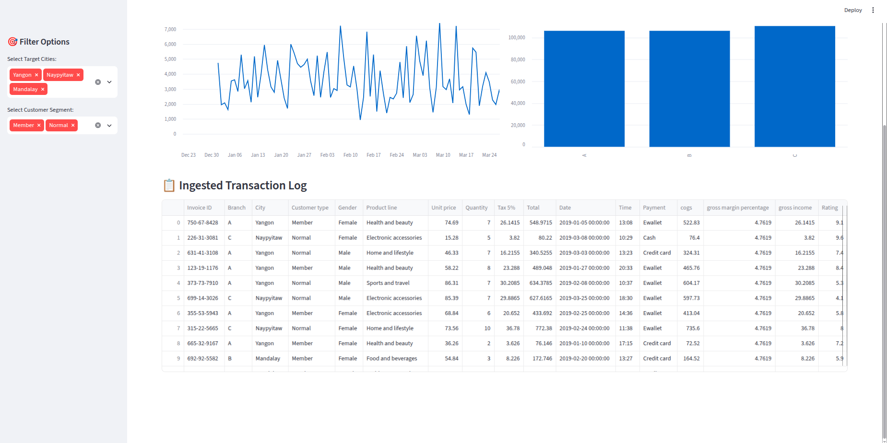

# 🛍️ Interactive Supermarket Retail Sales Dashboard

An interactive, multi-dimensional web application built with Python and **Streamlit** to analyze supermarket sales performance. The dashboard replaces static analytical charting with live filtering capabilities, dynamic KPI metrics tracking, and automated interactive data layouts.

## 🚀 Key Framework Features
* **Live Attribute Filtering:** Real-time multi-select filters for target operational regions (Yangon, Naypyitaw, Mandalay) and customer profiles (Member vs. Normal).
* **High-Level Operational KPIs:** Instantly aggregates global baseline data layers including total transaction revenue (\$322k+), overall volume metrics, and averaged sentiment indexes.
* **Automated Time-Series Visuals:** Dynamic tracking canvas plotting day-to-day sales performance to extract trend cycles.
* **Segment Analysis Profile:** Direct comparison matrices isolating structural volume distributions across individual business branches (A, B, C).
* **Ingested Transaction Log Grid:** Integrated tabular data viewer showing underlying raw transaction data entries on demand.

## 📊 Dashboard Interface Previews

### 1. Operations Canvas Layout
Main dashboard screen highlighting high-level operational key performance indicators alongside primary time-series and segment visual analytics layers.



### 2. Analytical Reporting Interface
Secondary view mapping expanded distributions and metrics parsed out by city groupings and target profile subsets.



## 🛠️ Environment Configuration & Deployment

### 1. Recreate Project Dependencies
Ensure you have initialized your Python virtual workspace, then install the necessary operational frameworks:
```bash
# Activate your local python environment workspace
source venv/bin/activate

# Install web UI and data layer dependencies
pip install streamlit pandas
```

### 2. Launch the Application Interface
Execute the runtime runner command from the repository root:
```bash
streamlit run app.py
```
*The terminal will initialize a local port routing directly to your web browser window at `http://localhost:8501`.*

## 📂 Core Project Architecture
```text
.
├── app.py              # Application configuration entrypoint script
├── retail.ipynb        # Data exploratory sandbox and patch validation notebooks
├── Dashboard_1.png     # Front-end UI application preview asset
├── Dashboard_2.png     # Alternate analytical reporting layout asset
├── .gitignore          # Environment file version tracking exclusions filter
└── README.md           # Application documentation (You are here)
```
